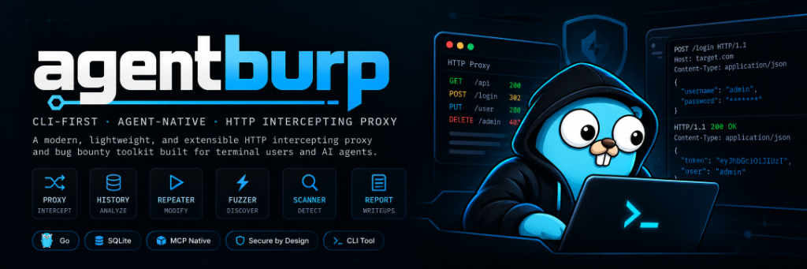
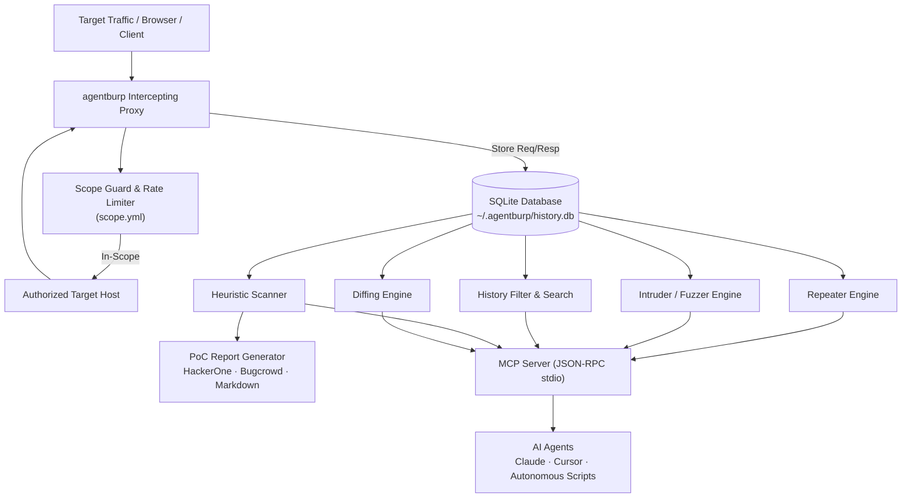

> [!NOTE]
> **Strict Scope & Authorization Requirement:** Only use `agentburp` against targets you are explicitly authorized to test. The engine refuses all traffic not listed in `scope.yml`'s `allow_hosts`.

<div align="center">



### A CLI-first, agent-native HTTP intercepting proxy and bug bounty toolkit.

Burp Suite's core workflow — proxy, history, repeater, intruder/fuzzer, diffing, heuristic scanning, and PoC reporting — re-engineered so AI agents and terminal power-users can drive security testing entirely through JSON output and an MCP stdio server, with no heavy GUI required.

[](https://golang.org)
[](https://pkg.go.dev/github.com/jojin1709/agentburp)
[](https://github.com/jojin1709/agentburp/releases)
[](https://modelcontextprotocol.io/)
[](https://github.com/jojin1709/agentburp)
[](./scope.yml)

**Developed by [JOJIN JOHN](https://www.linkedin.com/in/jojin-john/)**

[](https://www.linkedin.com/in/jojin-john/)
[](https://github.com/jojin1709)

<p><strong>Quick Launch</strong></p>

```powershell
# Windows (PowerShell - Works anywhere including System32)
irm https://raw.githubusercontent.com/jojin1709/agentburp/main/install.ps1 | iex
```

```bash
# Linux / macOS (curl)
curl -sSL -o agentburp https://github.com/jojin1709/agentburp/releases/latest/download/agentburp-linux-amd64 && chmod +x agentburp && ./agentburp proxy start --addr 127.0.0.1:8888
```

<sub>Zero installation required. Download and launch directly via PowerShell `irm` or `curl`.</sub>

---

</div>

> [!TIP]
> **AI Agents and LLMs:** Run `./agentburp mcp-serve` to connect `agentburp` directly to Claude, Cursor, or any Model Context Protocol (MCP) compatible AI agent over newline-delimited JSON-RPC stdio.

---

## Table of Contents

- [Table of Contents](#table-of-contents)
- [What is agentburp?](#what-is-agentburp)
  - [Why agentburp Exists](#why-agentburp-exists)
  - [Why "agentburp"?](#why-agentburp)
  - [Designed for Agents and Human Researchers](#designed-for-agents-and-human-researchers)
- [agentburp in Action](#agentburp-in-action)
- [Quick Start](#quick-start)
  - [Prerequisites](#prerequisites)
  - [1. Build agentburp](#1-build-agentburp)
  - [2. Configure Scope](#2-configure-scope)
  - [3. Start the Proxy](#3-start-the-proxy)
  - [4. Intercept, Replay, and Fuzz](#4-intercept-replay-and-fuzz)
- [Key Capabilities](#key-capabilities)
- [Command Reference](#command-reference)
- [MCP / Agent Integration](#mcp--agent-integration)
- [Architecture](#architecture)
- [Safety Rails & Scope Guard](#safety-rails--scope-guard)
- [Roadmap](#roadmap)
- [Common Questions](#common-questions)
- [Author & License](#author--license)

---

## What is agentburp?

`agentburp` brings the core capabilities of web security testing suites into a lightweight, headless, JSON-native CLI. Built with Go and SQLite, it acts as both a high-performance terminal tool for security engineers and a native stdio tool-server for autonomous LLM security agents.

<a id="why-agentburp-exists"></a>
<details>
<summary><strong>Why agentburp Exists</strong></summary>

Traditional GUI interception proxies like Burp Suite Professional and OWASP ZAP are designed for manual human clicks. When pairing with AI coding assistants, autonomous agents, and scriptable CI/CD workflows, GUIs introduce friction, heavyweight memory overhead, and clunky extension APIs.

`agentburp` strips away the heavyweight UI and provides pure JSON stdout, fast SQLite persistence, strict YAML scope enforcement, and an MCP server out of the box.

</details>

<a id="why-agentburp"></a>
<details>
<summary><strong>Why "agentburp"?</strong></summary>

It mirrors the indispensable workflow security researchers rely on in Burp Suite (Proxy -> HTTP History -> Repeater -> Intruder -> Scanner -> Report), but designed from the ground up for **Agents**: deterministic outputs, machine-parsable JSON, rate-limited execution, and MCP stdio integration.

</details>

<a id="designed-for-agents-and-human-researchers"></a>
<details>
<summary><strong>Designed for Agents and Human Researchers</strong></summary>

Whether you are an ethical hacker hunting bug bounties from your terminal, or configuring an autonomous AI pentester in a CI/CD pipeline, `agentburp` provides the exact tools needed to discover, isolate, and document vulnerabilities reliably.

</details>

---

## agentburp in Action

Every operation outputs clean, structured JSON formatted for machine-consumption and human readability:

| Tool Module | CLI Command | Purpose |
|---|---|---|
| **Proxy** | `agentburp proxy start` | Intercepts HTTP traffic and writes full request/response pairs into SQLite |
| **History** | `agentburp hist list` / `show` | Query and filter captured traffic by host, method, status code, or body text |
| **Repeater** | `agentburp repeat <id>` | Replay stored requests with modified headers, auth tokens, or payloads |
| **Fuzzer** | `agentburp fuzz <id>` | Parameter fuzzing against baselines with automated anomaly detection |
| **Diff** | `agentburp diff <a> <b>` | Structural diff of status codes, headers, and bodies between two requests |
| **Scanner** | `agentburp scan <id>` | Heuristic candidate checks (IDOR, open redirect, CORS, JWT, SSRF hints) |
| **Report** | `agentburp report <id>` | Generates ready-to-submit HackerOne, Bugcrowd, or Markdown PoC writeups |
| **MCP Server** | `agentburp mcp-serve` | Exposes full toolkit to AI agents over JSON-RPC stdio protocol |

---

## Quick Start

### 1. Download agentburp (No Git or Go Required)

#### Windows: Graphical Setup Installer (NSIS — Recommended)
- Download and run **[agentburp-setup.exe](https://github.com/jojin1709/agentburp/releases/latest/download/agentburp-setup.exe)**
  *(Auto-configures user PATH, adds Start Menu shortcuts, and installs cleanly without administrator rights)*

#### Windows: One-Line PowerShell Install
```powershell
irm https://raw.githubusercontent.com/jojin1709/agentburp/main/install.ps1 | iex
```

#### Linux (curl)
```bash
curl -sSL -o agentburp https://github.com/jojin1709/agentburp/releases/latest/download/agentburp-linux-amd64 && chmod +x agentburp
```

#### macOS (curl)
```bash
# Apple Silicon (M1/M2/M3/M4)
curl -sSL -o agentburp https://github.com/jojin1709/agentburp/releases/latest/download/agentburp-darwin-arm64 && chmod +x agentburp

# Intel Mac
curl -sSL -o agentburp https://github.com/jojin1709/agentburp/releases/latest/download/agentburp-darwin-amd64 && chmod +x agentburp
```

---

### 2. Configure Scope (`scope.yml`)

> [!WARNING]
> By design, `agentburp` blocks **all** requests by default unless explicitly allowed in `scope.yml`.

Download the starter scope configuration:

```powershell
# Windows (PowerShell)
irm https://raw.githubusercontent.com/jojin1709/agentburp/main/examples/scope.yml -OutFile scope.yml
```

```bash
# Linux / macOS (curl)
curl -sSL -o scope.yml https://raw.githubusercontent.com/jojin1709/agentburp/main/examples/scope.yml
```

Edit `scope.yml` to specify your in-scope hosts:

```yaml
workspace: mytarget

allow_hosts:
  - "target.com"
  - "*.target.com"

deny_hosts:
  - "payments.target.com"

rate_limit_per_sec: 10
safe_mode: true
```

### 3. Start the Proxy

```bash
# Switch to or create a named workspace
./agentburp workspace use mytarget

# Start the intercepting proxy listener
./agentburp proxy start --addr 127.0.0.1:8888
```

Configure your browser, mobile device, or HTTP client to route traffic through `http://127.0.0.1:8888`.

### 4. Intercept, Replay, and Fuzz

```bash
# View captured HTTP history
./agentburp hist list --host target.com --limit 20

# View request/response details for entry #12
./agentburp hist show 12

# Replay entry with an updated authorization token
./agentburp repeat 12 --set "Authorization: Bearer ATTACKER_TOKEN"

# Fuzz an ID parameter over numeric range 1..100
./agentburp fuzz 12 --param id --range-from 1 --range-to 100 --confirm

# Diff two requests to inspect authorization bypass or state differences
./agentburp diff 12 13

# Run heuristic vulnerability scans
./agentburp scan 12

# Generate a professional HackerOne PoC report
./agentburp report 12 --format hackerone
```

---

## Key Capabilities

- **CLI-First & Agent-Native**: No browser or GUI required. Works seamlessly over SSH, in scripts, CI pipelines, and with AI agents.
- **Strict Scope Guard**: Host matching with wildcard support (`*.target.com`), regex support, explicit deny lists, and default-deny safety.
- **Traffic Exporter (cURL & HAR 1.2)**: Export any captured HTTP request into an executable cURL command (`agentburp export <id> --format curl`) or export full session histories into standard HAR 1.2 archives (`agentburp export --format har --out session.har`) for Burp Suite, Caido, and DevTools.
- **Upstream Proxy Chaining**: Chain `agentburp` traffic directly into upstream proxies like Burp Suite Pro, Caido, or corporate gateways via `--upstream <url>` or `upstream_proxy:` in `scope.yml`.
- **Bug Bounty Header Injection**: Automatically inject bug bounty researcher identifiers (e.g. `X-Bug-Bounty: handle@platform`) or auth tokens into every outgoing proxy request via `--inject-header` or `inject_headers:` in `scope.yml`.
- **Safe Mode & Audit Logging**: Destructive fuzzing or active operations are barred without explicit confirmation (`--confirm`), and all actions are recorded in the SQLite audit log.
- **Built-in Rate Limiting**: Global request throttling protects target servers and prevents rate-limit bans during automated scans.
- **Zero Heavy Dependencies**: Pure Go with SQLite storage. Single binary deployment with instant startup.
- **Automated Bug Bounty Reporting**: Directly outputs formatted Markdown reports structured specifically for HackerOne and Bugcrowd submissions.
- **Native MCP Protocol**: Plug directly into AI agent workflows (Claude Code, Cursor, Windsurf, custom LLMs) via stdio JSON-RPC.

---

## Command Reference

```bash
Usage:
  agentburp proxy start [--addr 127.0.0.1:8888] [--scope scope.yml] [--upstream URL] [--inject-header "Name: Value"]...
  agentburp export [<id>] [--format curl|har] [--out FILE] [--limit N]
  agentburp hist list [--host H] [--method M] [--status N] [--body S] [--limit N]
  agentburp hist show <id>
  agentburp repeat <id> [--set "Header: value"]... [--body B]
  agentburp fuzz <baseline_id> --param NAME (--wordlist FILE | --range-from N --range-to N) [--anomalies] [--confirm]
  agentburp diff <id_a> <id_b>
  agentburp scan <entry_id>
  agentburp report <entry_id> [--format hackerone|bugcrowd|generic] [--finding-id N]
  agentburp workspace use <name>
  agentburp workspace current
  agentburp mcp-serve [--scope scope.yml]

Global:
  --scope PATH   path to scope.yml (default "scope.yml"), accepted by any subcommand
```

---

## MCP / Agent Integration

Launch `agentburp` as an MCP server to provide security tools directly to your LLM agent:

```bash
./agentburp mcp-serve --scope scope.yml
```

The server communicates via newline-delimited JSON-RPC over stdin/stdout:

```json
{"id": 1, "method": "history.search", "params": {"host": "target.com", "limit": 10}}
{"id": 2, "method": "fuzz", "params": {"baseline_id": 12, "param": "id", "range_from": 1, "range_to": 100}}
{"id": 3, "method": "diff", "params": {"a": 12, "b": 13}}
{"id": 4, "method": "scan", "params": {"entry_id": 12}}
```

Wire `agentburp` into Claude Desktop, Cursor, or any MCP client by adding it to your MCP configuration:

```json
{
  "mcpServers": {
    "agentburp": {
      "command": "/path/to/agentburp",
      "args": ["mcp-serve", "--scope", "/path/to/scope.yml"]
    }
  }
}
```

---

## Architecture



---

## Safety Rails & Scope Guard

1. **Default-Deny Policy**: Nothing is proxied, repeated, fuzzed, or scanned unless the host matches an entry in `allow_hosts`.
2. **Deny Overrides**: `deny_hosts` always overrides allow rules (useful for blacklisting sensitive payment or auth endpoints).
3. **Safe Mode**: Enabled by default in `scope.yml`. Blocks active attacks and fuzzing unless explicitly invoked with `--confirm`.
4. **Audit Trail**: Every active scan and fuzz operation is timestamped and recorded in the SQLite `audit_log` table with explicit reason metadata.
5. **Rate Limiting**: Built-in token bucket ensures requests never exceed the specified `rate_limit_per_sec`.

---

## Roadmap

- [ ] Full HTTPS MITM with auto-generated and installable CA certificates
- [ ] GraphQL-aware query parsing and mutation fuzzing
- [ ] Built-in OOB Collaborator (DNS/HTTP callback listener for blind SSRF/XXE)
- [ ] Secrets and credential leak detector for response bodies & JS bundles
- [ ] Autonomous crawler/spider for sitemaps, robots.txt, and endpoints
- [ ] WAF & rate-limit auto-detection with exponential backoff

---

## Common Questions

<details>
<summary><strong>Can an AI agent run agentburp completely autonomously?</strong></summary>

Yes. All commands output standard JSON, and `mcp-serve` implements a stdio JSON-RPC interface designed specifically for agents like Claude or custom LLM frameworks to execute scans, analyze responses, and replay attacks without human intervention.
</details>

<details>
<summary><strong>How does agentburp isolate different penetration tests?</strong></summary>

Via workspaces (`agentburp workspace use <name>`). Each workspace segments traffic, history, findings, and audit logs so multi-target testing never cross-contaminates data.
</details>

<details>
<summary><strong>Does agentburp require Burp Suite to be installed?</strong></summary>

No. `agentburp` is completely standalone, written in Go with an embedded SQLite engine. It has zero dependency on Burp Suite or Java.
</details>

---

## Author & License

**Developed with ❤️ by [JOJIN JOHN](https://www.linkedin.com/in/jojin-john/)**

- **LinkedIn:** [linkedin.com/in/jojin-john](https://www.linkedin.com/in/jojin-john/)
- **GitHub:** [@jojin1709](https://github.com/jojin1709)

This project is open-source software provided under the [MIT License](LICENSE).

> **Disclaimer:** Use responsibly and only against systems you are explicitly authorized to test. The author assumes no liability for unauthorized or illegal use of this software.
